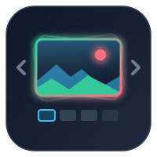
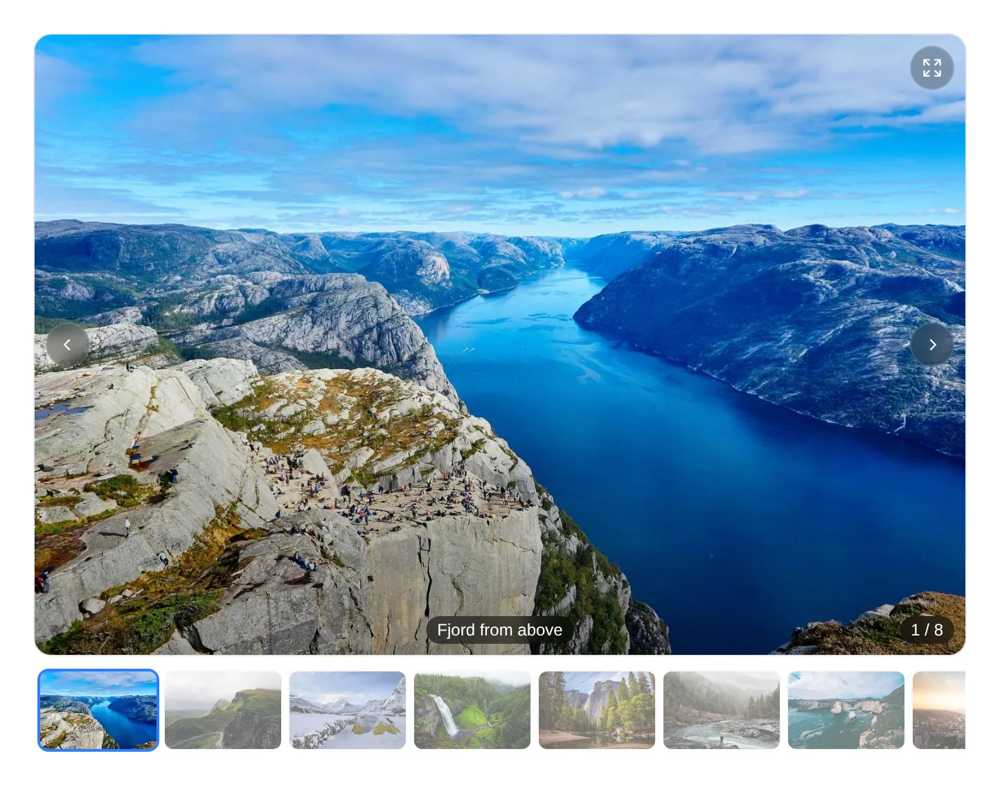
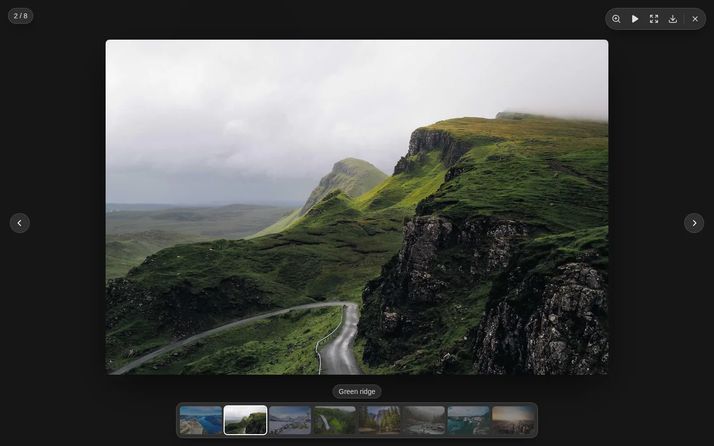
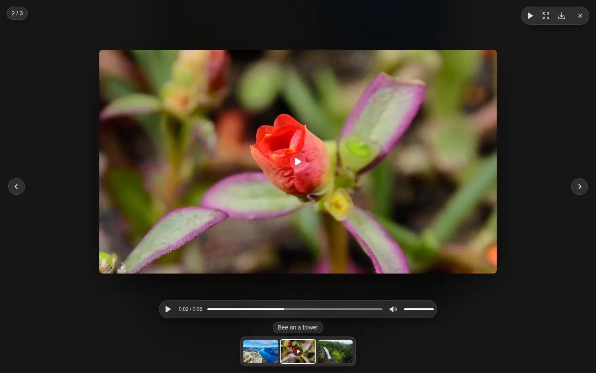

<p align="center">
  <a href="https://github.com/jonaaix/laravel-islands-gallery">
    
  </a>
</p>

<h1 align="center">Laravel Islands Gallery</h1>

<p align="center">
An image and video gallery for <a href="https://github.com/jonaaix/laravel-islands">Laravel Islands</a>: an inline carousel with thumbnails and a full-screen lightbox with zoom, pan, pinch, swipe, keyboard control, slideshow, fullscreen and video playback — in light and dark.
</p>

<p align="center">
  <a href="https://packagist.org/packages/aaix/laravel-islands-gallery"></a>
  <a href="https://packagist.org/packages/aaix/laravel-islands-gallery"></a>
  <a href="https://github.com/jonaaix/laravel-islands-gallery/blob/main/LICENSE.md"></a>
</p>

<p align="center">
  <a href="https://jonaaix.github.io/laravel-islands-gallery/"><strong>Live demo</strong></a>
</p>

---

<p align="center">
  
</p>

<p align="center">
  
</p>

Two Vue components share one image list. `Gallery` sits in the page; `Lightbox` takes over the
screen. The gallery brings its own lightbox, and the lightbox also works alone, opened from
anything you like.

- **Inline carousel** — a 3∶2 stage with arrows, swipe, counter and a thumbnail strip
- **Lightbox** — zoom at the pointer, pan, pinch, swipe, slideshow and fullscreen
- **Opens out of the picture** — the image grows from the thumbnail that was clicked and closes back into it
- **Videos beside images** — a poster with a play badge, playback controls in the same glass look
- **Keyboard and touch** — arrows, Esc and Space; swipe to step, drag down to close
- **Your wording** — every label is a prop, English fallbacks only

```vue
<script setup>
import { Gallery } from '@aaix/laravel-islands-gallery/vue';
</script>

<template>
    <Gallery :images="[{ src: '/photos/1.jpg', thumb: '/photos/1-small.jpg', caption: 'Front' }]" />
</template>
```

## Installation

```bash
composer require aaix/laravel-islands-gallery
```

Add the Vite plugin — it registers the import name `@aaix/laravel-islands-gallery` and, when the
package is installed from a Composer path repository, points it at the working copy:

```js
// vite.config.js
import islandsGallery from './vendor/aaix/laravel-islands-gallery/vite.js';

export default defineConfig({
    plugins: [/* … */ islandsGallery()],
});
```

Let Tailwind see the package's classes, in every stylesheet that renders islands:

```css
@source '../../vendor/aaix/laravel-islands-gallery/resources/js/**/*';
```

## Images

Every image is a plain object; only `src` is required.

```js
{ src: 'https://…/full.jpg', thumb: 'https://…/336.jpg', caption: 'Front view', alt: 'Die cutter, front' }
```

| Key | |
| --- | --- |
| `src` | The full-size image, also what the download saves |
| `thumb` | A small version for the thumbnail strip; falls back to `src` |
| `caption` | Shown on the stage and in the lightbox |
| `alt` | Alternative text; falls back to the caption |
| `filename` | Name of the saved file; falls back to the last part of the URL |
| `downloads` | Sizes to choose from, see [Download](#download) |
| `type` | `'video'` for a video; unset, a `.mp4`, `.m4v`, `.mov`, `.webm` or `.ogv` file counts as one |
| `poster` | Still image of a video, shown before it plays; see [Videos](#videos) |

Map whatever your server sends into this shape in a `computed` — the components read no other keys.

## Gallery

```vue
<Gallery :images="images" :labels="labels" @change="(index) => …" />
```

| Prop | Default | |
| --- | --- | --- |
| `images` | — | The list above; renders nothing when empty |
| `start` | `0` | Index shown first |
| `aspect` | `'3 / 2'` | Stage ratio |
| `fit` | `'cover'` | `'contain'` when nothing may be cropped — documents, drawings |
| `loop` | `true` | Wrap from the last image to the first |
| `thumbnails` | `true` | Strip below the stage |
| `lightbox` | `true` | A click or tap on the stage opens the full-screen view |
| `captions` | `true` | The current image's caption, bottom centre on the stage |
| `downloadable` | `true` | Download button in the lightbox |
| `autoplay` | `true` | A video starts playing when the lightbox shows it |
| `labels` | English | See [Wording](#wording) |

Emits `change(index)` whenever another image comes to the front. The arrows appear on hover and
stay hidden on touch devices, where the stage swipes.

## Lightbox

Use `Lightbox` alone when the trigger is something else — a table thumbnail, a button:

```vue
<Lightbox
    v-model:index="openIndex"
    :images="images"
    :labels="labels"
    :origin="(index) => thumbs[index]?.getBoundingClientRect()"
/>
```

`index` is `null` while closed. Set it to open; the lightbox writes it back on every step and
emits `close`.

| Prop | Default | |
| --- | --- | --- |
| `images` | — | The list above |
| `index` | `null` | The open image, `null` while closed — use `v-model:index` |
| `origin` | `null` | `(index) => DOMRect` of the picture on screen; the image zooms out of it and back into it |
| `originRadius` | `12` | Corner radius of that picture in px, so the shape matches on the way back |
| `loop` | `true` | Wrap from the last image to the first |
| `thumbnails` | `true` | Strip along the bottom |
| `slideshowInterval` | `4000` | Milliseconds per image in the slideshow |
| `maxZoom` | `4` | Largest zoom factor |
| `downloadable` | `true` | Download button in the toolbar |
| `autoplay` | `true` | A video starts playing when it comes to the front |
| `labels` | English | See [Wording](#wording) |

| Input | Effect |
| --- | --- |
| <kbd>←</kbd> <kbd>→</kbd>, swipe | Previous / next image |
| Click, double tap | Zoom in at the pointer, again to zoom out |
| Wheel, pinch | Zoom continuously |
| Drag | Pan a zoomed image |
| <kbd>Esc</kbd> | Zoom out first, then close |
| Drag down (touch) | Close |
| Tap | Hide or show the controls |
| <kbd>Space</kbd> | Start or pause the slideshow |

The toolbar carries the counter, zoom, slideshow, fullscreen, download and close. The lightbox
sits on the modal layer (z-index 70) and is rendered into `body`, so it also opens from inside a
modal.

### Open from anywhere

`openLightbox` opens one shared lightbox without placing a component — for a photo in a table cell,
a card or a list:

```js
import { openLightbox } from '@aaix/laravel-islands-gallery/vue';

openLightbox(images, {
    start: index,
    origin: (position) => thumbs[position]?.getBoundingClientRect() ?? null,
    labels,
});
```

`start` is the image shown first; every other option is a `Lightbox` prop. The lightbox mounts on
first use and is reused after that.

## Videos

<p align="center">
  
</p>

A video sits in the same list as the images:

```js
{ type: 'video', src: 'https://…/demo.mp4', poster: 'https://…/demo.jpg', thumb: 'https://…/demo-336.jpg', caption: 'Running at full speed' }
```

The gallery stage and the thumbnail strip show the poster with a play badge; without a `poster` they
show the video's first frame. A click on the stage opens the lightbox, where the video starts
playing. With `:lightbox="false"` the video plays in place on the stage instead.

In the lightbox the video takes the image's place and keeps its gestures: swipe to step, drag down to
close. Zoom is off. A control bar below the video carries play and pause, the time, a seek bar that
shows what has loaded, mute and — on devices with a pointer — the volume.

| Input | Effect |
| --- | --- |
| Click on the video, <kbd>Space</kbd>, <kbd>K</kbd> | Play / pause |
| <kbd>M</kbd> | Mute / unmute |
| <kbd>←</kbd> <kbd>→</kbd> | Previous / next item, as with images |
| <kbd>←</kbd> <kbd>→</kbd> on the focused seek bar | Back / forward 5 seconds |

- The controls fade out after a few seconds of playback and return when the pointer moves or the
  screen is tapped.
- Leaving a video pauses it; coming back resumes where it stopped.
- The slideshow plays a video to its end before it moves on.
- Download saves the video file, like an image.

Prefer MP4 (H.264) or WebM: every browser plays them. A video on another domain plays without CORS
headers, but needs them to be saved in place by the download button.

## Download

The download button saves `src` under `filename`. To offer several sizes, give the image a
`downloads` list — the button then opens a menu with one entry per size:

```js
{
    src: 'https://…/1500.jpg',
    filename: 'die-cutter-front.jpg',
    downloads: [
        { label: t('Original'), src: 'https://…/original.jpg', filename: 'die-cutter-front.jpg' },
        { label: t('Web (1500 px)'), src: 'https://…/1500.jpg', filename: 'die-cutter-front-1500.jpg' },
    ],
}
```

An entry without `filename` takes the image's. Name files after the record, not the position, so
two downloads never collide.

The file is fetched and saved in place. When the server refuses that — another domain without CORS
headers — the browser opens the image in a new tab instead, where it can still be saved by hand.

## Wording

The package ships English fallbacks only. Pass your own strings through your translation layer:

```js
const labels = computed(() => ({
    dialog: t('Image viewer'),
    counter: t(':current / :total'),
    image: t('Image :number'),
    open: t('Open image'),
    previous: t('Previous image'),
    next: t('Next image'),
    close: t('Close'),
    zoomIn: t('Zoom in'),
    zoomOut: t('Zoom out'),
    play: t('Start slideshow'),
    pause: t('Pause slideshow'),
    fullscreen: t('Full screen'),
    exitFullscreen: t('Exit full screen'),
    download: t('Download'),
    video: t('Video :number'),
    playVideo: t('Play'),
    pauseVideo: t('Pause'),
    seek: t('Seek'),
    mute: t('Mute'),
    unmute: t('Unmute'),
    volume: t('Volume'),
}));
```

`:current`, `:total` and `:number` are filled in by the package. Keys you leave out keep their
English fallback.

## Demo

`demo/` is a standalone page with the gallery and sample photos, no Laravel app needed. Every push
to `main` publishes it as the [live demo](https://jonaaix.github.io/laravel-islands-gallery/). To run it locally:

```bash
cd demo
npm install
npm run dev
```

The browser tests run against the same page and on every push:

```bash
npx playwright install chromium
npm test
```

## License

[MIT](LICENSE.md)

Sample photos in the screenshots: [Unsplash](https://unsplash.com/license). Sample video in the demo: [MDN](https://developer.mozilla.org/en-US/docs/Web/HTML/Reference/Elements/video), CC0.
